# logcanary

On my lab pipeline, Fluent Bit with its default settings lost 84.8% of the journal-path canaries written on an Ubuntu 24.04 host while Elasticsearch was down for 10 minutes, and 82 of the 124 lossy streams across 25 conditions left no log line anywhere saying events were lost.

logcanary writes numbered test events ("canaries") through a host's real logging paths (rsyslog
and journald), keeps the ground truth in a ledger on the host, and counts them again in the SIEM:
loss, duplicates, delay, field damage, clock skew, and whether anything said a word about it.
Three shippers (Filebeat 8.19.25, Fluent Bit 5.1.5, Vector 0.61.0) read the same host at the same
time into Elasticsearch 8.19.25, so every run measures all three under the same fault.

## Results

88 runs, 1,561,800 canaries (each written once per path), 25 conditions, 2 to 5 repeats each,
all on one Docker lab. Loss is the mean share of canaries never indexed, file path / journal path.
Full table with 95% intervals, latency, fidelity, skew and rule blind spots:
[`results/table.md`](results/table.md); per run: [`results/runs.csv`](results/runs.csv).

| Condition | n | Filebeat file / journal | Fluent Bit file / journal | Vector file / journal | Silent streams | Runs during ES throttling |
|---|---|---|---|---|---|---|
| Steady 20/s for 90 s | 5 | 0 / 0 | 0 / 0 | 0 / 0 | 0 of 30 | 0 of 5 |
| Burst: 10,000 at 1,000/s | 5 | 0 / 0 | 0 / 0 | 0 / 0 | 0 of 30 | 1 of 5 |
| Burst: 20,000 in 5 s (4,000/s) | 5 | 0 / 0 | 0 / 0 | 0 / 0 | 0 of 30 | 5 of 5 |
| Burst: 50,000 as fast as the writer can | 3 | 0 / 0 | 0 / 0 | 7.56 / 17.7 | 5 of 18 | 3 of 3 |
| Shipper restart (SIGTERM) at 30 s | 5 | 0 / 0 | 1.26 / 1.32 | 0 / 0 | 10 of 30 | 5 of 5 |
| Shipper crash (SIGKILL) at 30 s, back at 40 s | 5 | 0 / 0 | 13.3 / 13.5 | 0.03 / 0.39 | 16 of 30 | 5 of 5 |
| Network partition 60 s | 5 | 0 / 0 | 42.3 / 42.5 | 0 / 0 | 0 of 30 | 5 of 5 |
| Network partition 300 s | 3 | 0 / 0 | 80.4 / 80.5 | 0 / 0 | 0 of 18 | 3 of 3 |
| Elasticsearch stopped for 120 s | 3 | 0 / 0 | 75.4 / 75.1 | 0 / 0 | 0 of 18 | 1 of 3 |
| Elasticsearch stopped for 10 min | 2 | 0 / 0 | 84.6 / 84.8 | 0 / 0 | 0 of 12 | 0 of 2 |
| Elasticsearch frozen (paused) for 120 s | 3 | 0 / 0 | 0 / 0 | 0 / 0 | 0 of 18 | 0 of 3 |
| Message sizes 1 KB to 64 KB | 3 | 0 / 0 | 0 / 0 | 0 / 0 | 0 of 18 | 0 of 3 |
| Multiline, unicode and control characters | 3 | 0 / 0 | 0 / 0 | 0 / 0 | 0 of 18 | 0 of 3 |
| Host clock +2 h from 30 s to 90 s | 3 | 0 / 49.5 | 0 / 49.5 | 0 / 49.5 | 9 of 18 | 0 of 3 |
| Host clock -10 min from 30 s to 90 s | 3 | 0 / 0 | 0 / 0 | 0 / 0 | 0 of 18 | 3 of 3 |
| Log rotation (Ubuntu stock logrotate) and journal rotation | 3 | 0 / 0 | 0 / 0 | 0 / 0 | 0 of 18 | 3 of 3 |
| Log rotation with copytruncate | 3 | 1.68 / 0 | 0 / 0 | 0.02 / 0 | 5 of 18 | 2 of 3 |
| Journal rotate and vacuum to 1 MB mid-stream | 3 | 0 / 0 | 0 / 0 | 0 / 0 | 0 of 18 | 3 of 3 |
| rsyslog and journald SIGKILL at 30 s (restarted within 1 s) | 5 | 0.80 / 0.91 | 0.80 / 0.91 | 0.80 / 0.91 | 30 of 30 | 5 of 5 |
| Partition 150 s with aggressive rotation and an 8 MB journal cap (100/s, 2 KB) | 3 | 0 / 42.7 | 70.5 / 70.0 | 29.2 / 39.7 | 3 of 18 | 3 of 3 |
| Shipper restart (SIGTERM) at 30 s (tuned shippers) | 3 | 0 / 0 | 0 / 0 | 0 / 0 | 0 of 18 | 3 of 3 |
| Shipper crash (SIGKILL) at 30 s, back at 40 s (tuned shippers) | 3 | 0 / 0 | 0 / 0 | 0 / 0.11 | 1 of 18 | 3 of 3 |
| Network partition 60 s (tuned shippers) | 3 | 0 / 0 | 0 / 0 | 0 / 0 | 0 of 18 | 3 of 3 |
| Elasticsearch stopped for 120 s (tuned shippers) | 3 | 0 / 0 | 0 / 0 | 0 / 0 | 0 of 18 | 0 of 3 |
| Partition 150 s with aggressive rotation and an 8 MB journal cap (100/s, 2 KB) (tuned shippers) | 3 | 0 / 43.9 | 0 / 0 | 5.35 / 5.40 | 3 of 18 | 0 of 3 |

A silent stream is one run, shipper and path that lost canaries while neither the shipper's log
nor the host daemon on that path wrote a line about lost, dropped or discarded events. Nothing in
any of these pipelines sent a loss signal to Elasticsearch itself. "Runs during ES throttling":
see What went wrong below.

What the numbers say, for this configuration on this machine:

- **Fluent Bit's defaults drop data whenever the output is unreachable for long.** With its
  default retry limit it lost 42.3% of file-path canaries over a 60 s partition, 75.4% over a
  2 minute Elasticsearch outage and 84.6% over 10 minutes. It did log "cannot be retried" each
  time, so those streams are not silent. With the documented reliability settings (offset DB,
  filesystem storage, `Retry_Limit False`) it lost 0 in the restart, crash, partition and
  outage conditions.
- **Not lost is not the same as seen.** During the 10 minute outage Filebeat and Vector lost
  nothing, but their canaries arrived so late (median 303.0 s and 1300.9 s on the file path) that a
  rule running every 5 minutes over the last 6 would miss 63.0% and 98.0% of them. A host clock
  10 minutes slow lost nothing and still hid 50.0% of the file-path canaries from that rule.
- **Some loss happens on the host, and nobody says so.** Killing rsyslog and journald (restarted
  within a second, as systemd would) lost 0.80% of file-path and 0.91% of journal-path canaries
  in every run, identically for all three shippers, and all 30 streams were silent.
- **copytruncate rotation loses whatever a shipper had not read yet.** Filebeat lost 1.68% of
  file-path canaries on average, Vector 0.02%, Fluent Bit none, all silent (hand check 2 in
  [`results/handchecks.md`](results/handchecks.md)).
- **Big and odd messages are damaged on the file path only.** No 8,200-byte or larger canary
  arrived intact through rsyslog with any shipper (stock 8 KB message limit), and no multiline or
  control-character canary did; through journald every size and kind arrived intact
  ([`docs/img/fidelity.png`](docs/img/fidelity.png)).
- **Steady load is fine but not instant.** At 20 events/s nothing was lost; median delay was
  6.5 s for Filebeat on the file path against 519 ms for Fluent Bit and 584 ms for Vector.

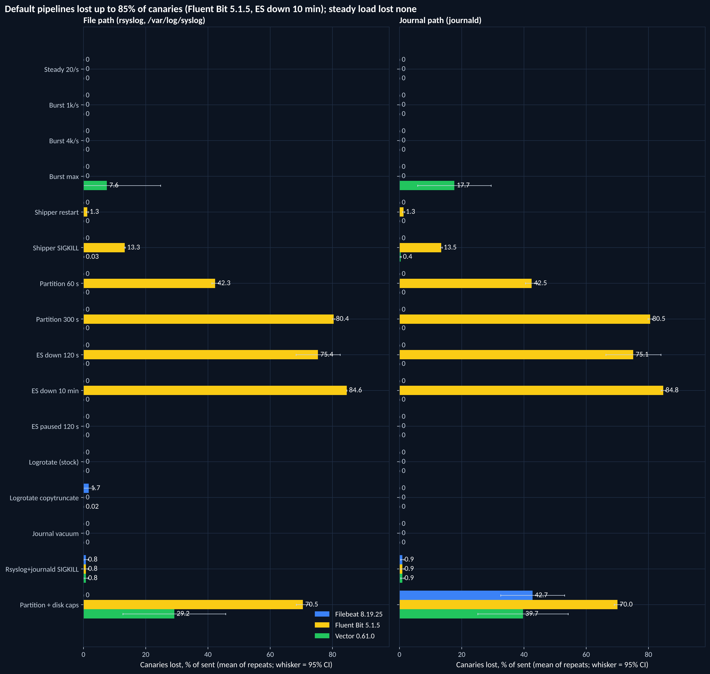

| | |
|---|---|
| 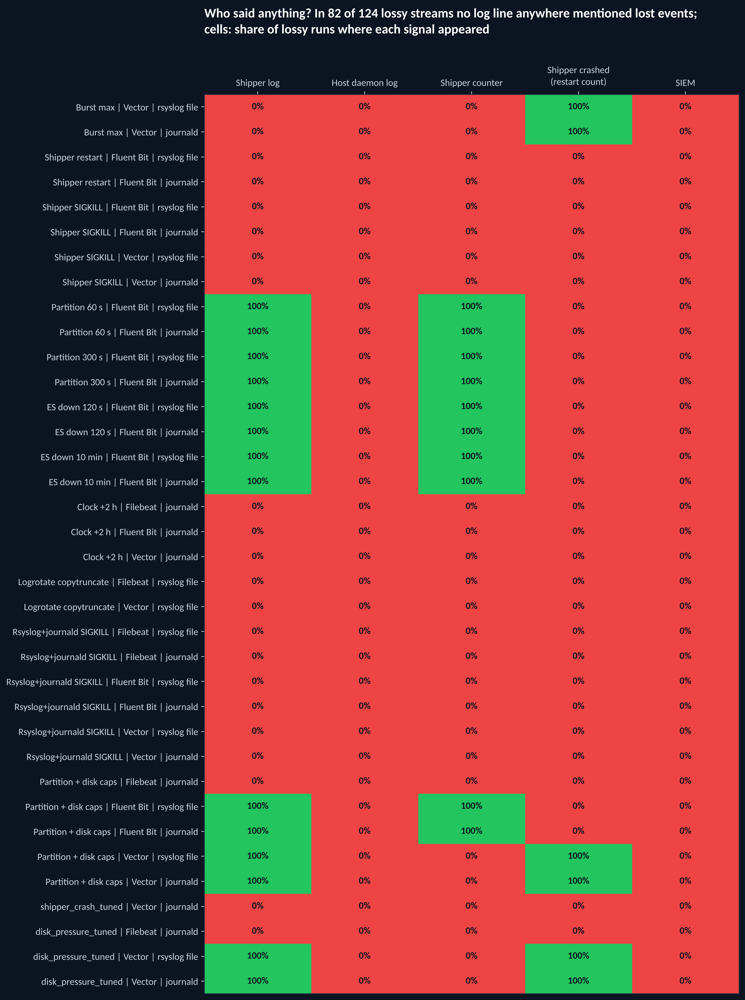 | 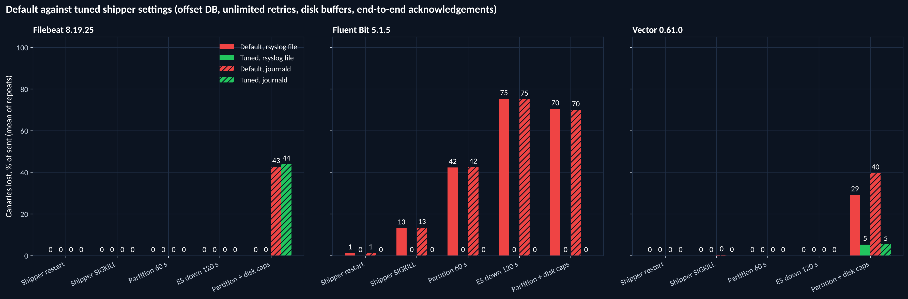 |
| 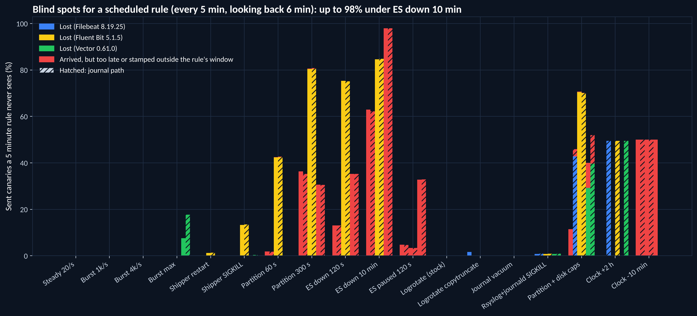 | 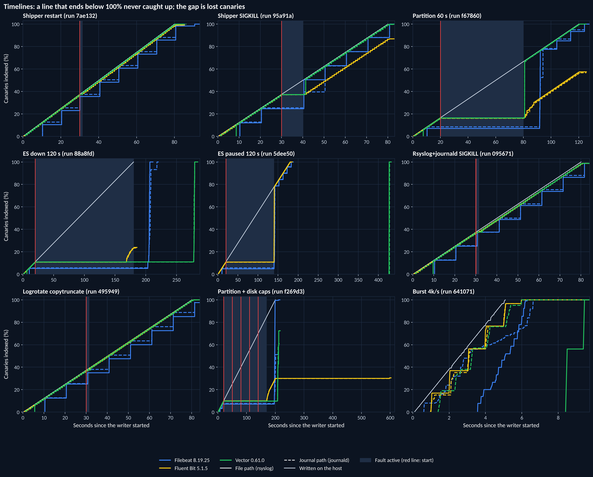 |
| 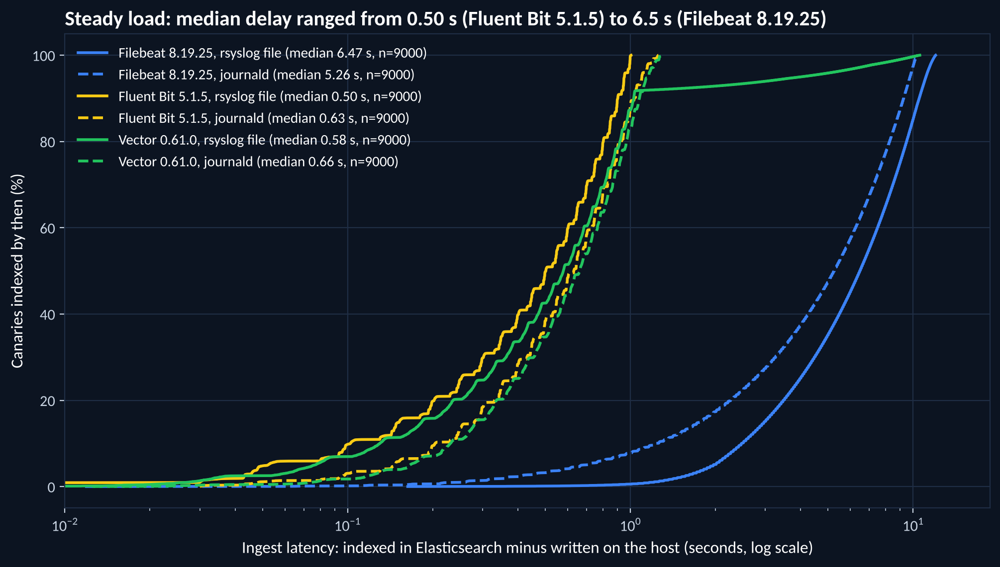 | 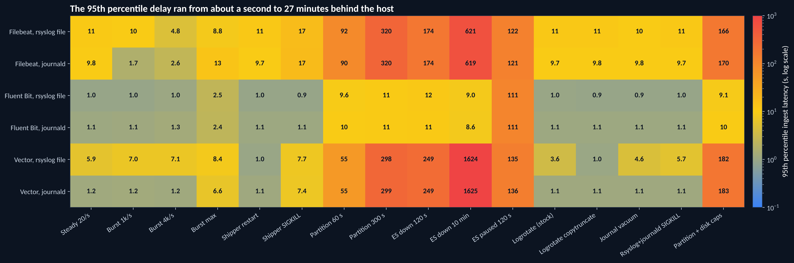 |
| 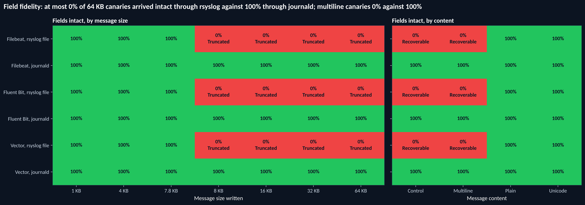 | 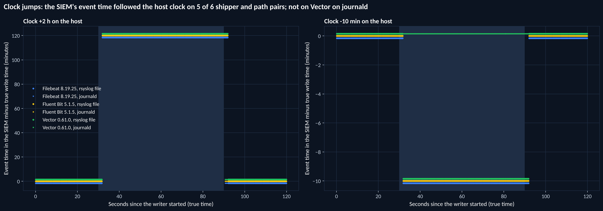 |
| 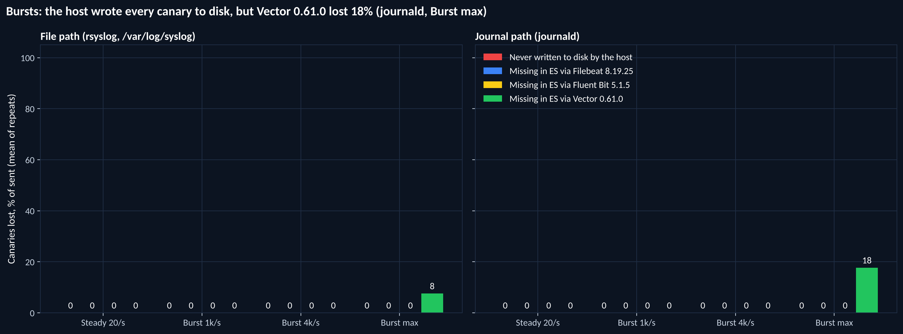 | 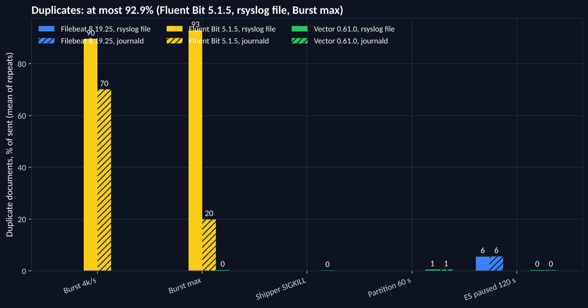 |

Every number above is in [`results/table.md`](results/table.md),
[`results/conditions.csv`](results/conditions.csv) or [`results/summary.json`](results/summary.json),
all built by `logcanary report` and `logcanary summary` from the per-run result files.

## How it works

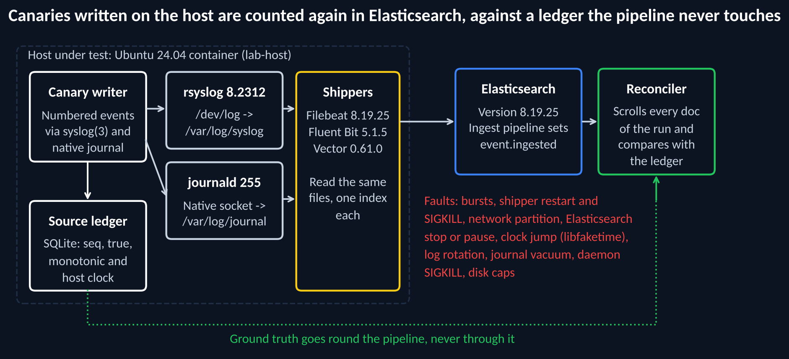

The writer on the host sends each canary through `syslog(3)` to rsyslog (`/var/log/syslog`) and
through the native journal socket to journald, and records it in a SQLite ledger. The shippers
read those files as host agents would. After each run settles, the reconciler scrolls every
document of the run out of Elasticsearch and compares it with the ledger; a second, final
reconcile runs at least 15 minutes later. Faults are injected on a schedule: shipper restart and
SIGKILL, network partition, Elasticsearch stop and pause, host clock jumps (libfaketime), log
rotation, journal vacuum, daemon SIGKILL and disk caps. Each condition was run with each
shipper's smallest documented config, and five of them again with the reliability settings each
project documents. Definitions of every metric: [`docs/method.md`](docs/method.md).

## What went wrong

The full list, with what each item does to the numbers, is in
[`docs/what-went-wrong.md`](docs/what-went-wrong.md). The ones that matter most:

- **Elasticsearch throttled indexing during 56 of the 88 runs**: the shared build disk was nearly
  full, so Elasticsearch held merges back and slowed indexing. Those runs are marked in every
  table. Latency and some loss in them may be partly this. The setting was fixed for the last runs
  and in `logcanary lab-up`; the marked runs were not repeated.
- **The +2 h clock row may be a lab artefact.** journald kept exiting under the fake clock and
  lost about half the journal-path canaries; that may be libfaketime rather than journald.
- **13 runs failed on 14 November without writing a result** and were run again on 20 November;
  three early `burst_max` runs were discarded because the shippers had no restart policy
  (kept in `results/discarded/`, in no table).
- **Not run:** auditd, a second distribution (an Ubuntu 22.04 host is defined but was never
  run), Windows, Splunk, and the guide's "rules that died silently" phase with real Sigma rules.
- **One lab is one lab.** Containers, not VMs; one machine shared with other work; 2 to 5 repeats.
  See [`docs/limits.md`](docs/limits.md).

## Prior art

I could not find an open tool that writes numbered events through a host's own syslog and journald
paths, keeps the ground truth on the host and reconciles it against the SIEM under injected
faults. The closest are the
[VictoriaMetrics log collector benchmark](https://victoriametrics.com/blog/log-collectors-benchmark-2026/)
(loss and throughput under load, no faults, no syslog or journald) and
[eddiechu/event-log-load-test](https://github.com/eddiechu/event-log-load-test) (counts a labelled
batch of Windows events end to end). More, including vendor features: [`docs/prior_art.md`](docs/prior_art.md).

## Reproduce

```bash
make test        # ruff and unit tests
uv run logcanary report --check   # every table and summary.json follow from the committed run files
make lab         # build the host image, start Elasticsearch, the host and three shippers (about 3 GB RAM)
make reproduce   # run the matrix (hours), final reconcile, tables, charts, summary, raw hashes
make clean-lab   # stop the lab and delete its volumes
```

The repository holds each run's compact files (`meta.json`, `alerts.json`, `result.json`,
`result_settle.json`, shipper logs). The raw ledgers and arrivals (about 76 MB) are not committed;
their SHA-256 hashes are in [`results/raw_sha256.txt`](results/raw_sha256.txt) and `make check-raw`
verifies a copy. With only the committed files, `make results` rebuilds every table and
`results/summary.json`; the latency, timeline and clock charts need the raw files.

## Layout

```
src/logcanary/   writer, ledger, faults, reconciler, metrics, report, figures, summary, CLI
lab/             docker-compose.yml, host images, shipper configs (default and tuned), ES pipeline
results/         runs/<condition>/r<n>-<run>/, runs.csv, conditions.csv, table.md, handchecks.md
docs/            method, limits, prior art, what went wrong, charts
scripts/         hand-check helper, Elasticsearch log extractor
```

MIT licence. Copyright Ashutosh Pal Singh.
